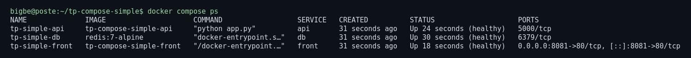
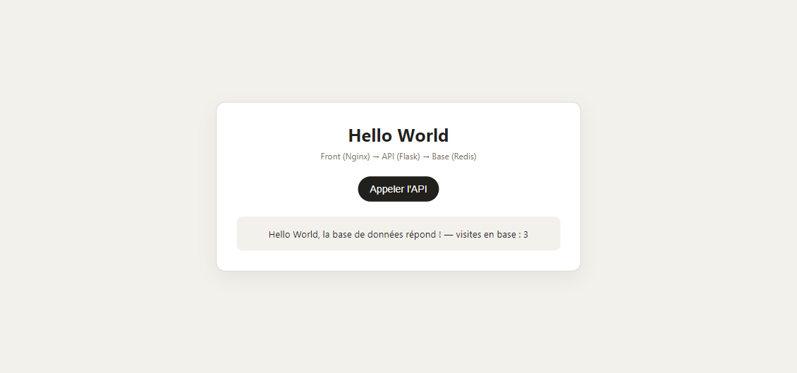
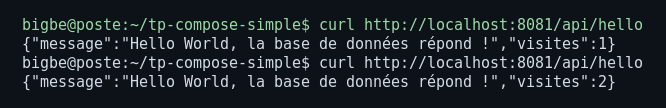
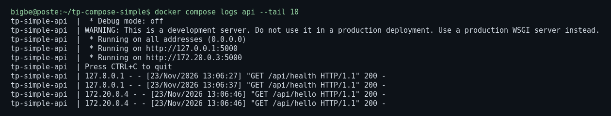

# TP Compose — front + API + base de données

Un projet **volontairement simple** pour comprendre Docker Compose : trois
services qui discutent entre eux, un seul fichier `docker-compose.yml`, et
**une seule commande** pour tout démarrer.

> Ce projet s'appelle **TP Compose** (et non « TP Docker ») : ici, aucun
> conteneur n'est lancé à la main avec `docker run`. Tout est décrit dans
> `docker-compose.yml` et rejouable en une commande.

---

## 1. Ce que fait le projet

1. Vous ouvrez une page web.
2. Un clic sur le bouton envoie une demande à l'API.
3. L'API **écrit** un compteur dans la base de données, puis **relit** le
   message de bienvenue.
4. La page affiche la réponse : le message et le nombre de visites.

```
   Navigateur
       │  http://localhost:8080
       ▼
   ┌─────────────┐   /api/hello    ┌─────────────┐    lecture/écriture   ┌─────────────┐
   │    FRONT    │ ──────────────► │     API     │ ────────────────────► │    BASE     │
   │   (Nginx)   │ ◄────────────── │   (Flask)   │ ◄──────────────────── │   (Redis)   │
   └─────────────┘      JSON       └─────────────┘                       └─────────────┘
        port 8080                   port 5000                            port 6379
     (ouvert sur                  (interne : on y                     (interne : jamais
      votre machine)               accède via le front)                ouverte dehors)
```

**Point important :** le navigateur ne parle **jamais** directement à la base de
données. Il ne connaît qu'une adresse : le front. C'est le front qui transmet
les appels `/api/…` à l'API, et c'est l'API seule qui touche la base.

## 2. Les trois services

| Service | Fichier(s) | Rôle | Techno |
| --- | --- | --- | --- |
| `front` | `front/index.html`, `front/nginx.conf` | Affiche la page et transmet `/api/` à l'API | Nginx + HTML/JS |
| `api` | `api/app.py` | Répond à `/api/hello` en lisant/écrivant dans la base | Python + Flask |
| `db` | *(rien à écrire)* | Garde un compteur de visites et un message | Redis |

## 3. Arborescence

```
tp-compose-simple/
├── docker-compose.yml        ← le fichier qui décrit les 3 services
├── .env.example              ← modèle de configuration (valeurs factices)
├── .gitignore                ← empêche d'envoyer .env sur GitHub
├── README.md                 ← ce document
├── api/
│   ├── app.py                ← le code de l'API (commenté)
│   ├── requirements.txt      ← les 2 bibliothèques Python utilisées
│   └── Dockerfile            ← comment construire l'image de l'API
├── front/
│   ├── index.html            ← la page (HTML + style + script dans un fichier)
│   ├── nginx.conf            ← sert la page et transmet /api/ à l'API
│   └── Dockerfile            ← comment construire l'image du front
└── captures/
    └── LISEZ-MOI.md          ← où déposer vos captures d'écran
```

## 4. Le fichier `.env.example` (variables factices)

Il n'y a **aucun vrai mot de passe** dans ce dépôt. Le fichier `.env.example`
donne seulement un modèle :

| Variable | Valeur d'exemple | À quoi ça sert |
| --- | --- | --- |
| `FRONT_PORT` | `8080` | Le port ouvert sur votre machine. Le site sera sur `http://localhost:8080`. |
| `REDIS_PASSWORD` | `mot_de_passe_factice` | Le mot de passe de la base Redis. **Valeur factice** : elle sert juste à montrer comment on passe un mot de passe par une variable d'environnement, sans l'écrire dans le code. |

Pour l'utiliser, on copie le modèle :

```bash
cp .env.example .env
```

Le fichier `.env` reste sur votre ordinateur : il est listé dans `.gitignore`,
donc **il ne partira jamais sur GitHub**.

> Si vous ne créez pas de `.env`, le projet démarre quand même : le
> `docker-compose.yml` contient les mêmes valeurs factices par défaut
> (`${FRONT_PORT:-8080}`). C'est pratique pour tester, mais la bonne habitude
> reste de créer son `.env`.

## 5. Lancer le projet

**Ce qu'il faut :** Docker (avec le plugin Compose v2). Rien d'autre : Python,
Redis et Nginx tournent **dans les conteneurs**.

```bash
# 1. Se placer dans le dossier du projet
cd tp-compose-simple

# 2. Créer sa configuration locale
cp .env.example .env

# 3. Construire les images et démarrer les 3 services
docker compose up -d --build
```

Puis ouvrir **<http://localhost:8080>** dans le navigateur : la page doit
afficher *« Hello World, la base de données répond ! — visites en base : 1 »*.

> Le premier lancement prend une à deux minutes (téléchargement des images et
> installation de Flask). Les fois suivantes, c'est presque immédiat.

## 6. Vérifier que tout fonctionne

### a) Les trois services tournent

```bash
docker compose ps
```

Vous devez voir **trois lignes** avec `(healthy)`. C'est Docker qui vérifie
lui-même que chaque service répond.

### b) L'API répond, à travers le front

```bash
curl http://localhost:8080/api/hello
```

Réponse attendue (le compteur augmente de 1 à chaque appel) :

```json
{"message": "Hello World, la base de données répond !", "visites": 2}
```

### c) La valeur est bien enregistrée dans la base

```bash
docker compose exec db redis-cli -a mot_de_passe_factice get visites
```

La commande affiche le même nombre que celui renvoyé par l'API. **C'est la
preuve que l'API écrit bien dans la base de données.**

### d) Lire les logs

```bash
docker compose logs api
docker compose logs db
```

## 7. Arrêter le projet

```bash
docker compose stop     # arrête les services (on peut les relancer)
docker compose down     # arrête et supprime les conteneurs et le réseau
```

> La base Redis n'a pas de volume de stockage : le compteur **repart de zéro**
> quand on fait `docker compose down`. C'est normal et sans conséquence pour
> un TP.

## 8. Preuves de fonctionnement (pour la remise)

Voici les commandes à lancer et **la sortie attendue**. Il faut ensuite les
remplacer par **vos propres captures d'écran**, déposées dans `captures/`
(voir `captures/LISEZ-MOI.md` pour les noms de fichiers et comment les faire).

> Les exemples ci-dessous utilisent le port `8080`. Si vous avez changé
> `FRONT_PORT`, remplacez-le par votre valeur.

### 8.1 `docker compose ps` — les trois services sont « healthy »

```console
$ docker compose ps
NAME              IMAGE                     COMMAND                  SERVICE   CREATED          STATUS                    PORTS
tp-simple-api     tp-compose-simple-api     "python app.py"          api       26 seconds ago   Up 21 seconds (healthy)   5000/tcp
tp-simple-db      redis:7-alpine            "docker-entrypoint.s…"   db        2 minutes ago    Up 2 minutes (healthy)    6379/tcp
tp-simple-front   tp-compose-simple-front   "/docker-entrypoint.…"   front     22 seconds ago   Up 15 seconds (healthy)   0.0.0.0:8080->80/tcp
```

À retenir : seul le front affiche un port (`0.0.0.0:8080->80/tcp`). Les mentions
`5000/tcp` et `6379/tcp` sans flèche signifient « port interne, non ouvert sur
votre machine ».

### 8.2 `curl` — l'API répond et le compteur augmente

```console
$ curl http://localhost:8080/api/hello
{"message":"Hello World, la base de données répond !","visites":4}

$ curl http://localhost:8080/api/hello
{"message":"Hello World, la base de données répond !","visites":5}
```

### 8.3 `curl` sur la route de santé

```console
$ curl http://localhost:8080/api/health
{"base":"connectée","etat":"ok"}
```

### 8.4 La valeur réellement stockée dans Redis

```console
$ docker compose exec db redis-cli -a mot_de_passe_factice get visites
5

$ docker compose exec db redis-cli -a mot_de_passe_factice get message
Hello World, la base de données répond !
```

### 8.5 Les logs de l'API

```console
$ docker compose logs api --tail 5
tp-simple-api  | 172.20.0.4 - - [23/Nov/2026 13:00:31] "GET /api/hello HTTP/1.1" 200 -
tp-simple-api  | 172.20.0.4 - - [23/Nov/2026 13:00:31] "GET /api/hello HTTP/1.1" 200 -
```

Les lignes `GET /api/health` qui reviennent régulièrement sont les
vérifications automatiques de Docker (le « healthcheck ») : c'est normal.

### 8.6 Où mettre les captures d'écran

| Capture | Commande ou action | Nom de fichier conseillé |
| --- | --- | --- |
| Les 3 services | `docker compose ps` | `captures/1-docker-compose-ps.png` |
| La page web | navigateur sur `http://localhost:8080` | `captures/2-navigateur.png` |
| L'API | `curl http://localhost:8080/api/hello` | `captures/3-curl.png` |
| Les logs | `docker compose logs api` | `captures/4-logs.png` |

Les quatre captures sont **déjà présentes** dans `captures/` et affichées
ci-dessous. Remplacez-les par les vôtres si vous voulez montrer votre propre
machine (gardez les mêmes noms de fichiers).









> **Transparence sur les captures** : `1-docker-compose-ps.png`, `3-curl.png` et
> `4-logs.png` ont été générées à partir des **sorties réelles** des commandes,
> recopiées dans une image (fond sombre, police monospace). Ce ne sont donc pas
> des copies d'écran d'une fenêtre de terminal. Seule la capture
> `2-navigateur.png` est une vraie capture du navigateur.
>
> Ces captures ont été faites avec `FRONT_PORT=8081`, car le port 8080 était
> déjà occupé sur le poste de test. Chez vous, utilisez le port indiqué dans
> votre `.env` (8080 par défaut).

## 9. Comment ça marche (en 4 idées)

1. **Un service = un conteneur.** `docker-compose.yml` décrit trois services :
   `db`, `api`, `front`. Compose crée un conteneur pour chacun.
2. **Les services se parlent par leur nom.** L'API utilise `REDIS_HOST=db`,
   parce que `db` est le nom du service dans le fichier Compose. Docker le
   transforme en adresse réseau.
3. **Un seul port ouvert.** Seul le front publie un port (`8080`). La base et
   l'API restent à l'intérieur du réseau Docker.
4. **Les mots de passe passent par l'environnement.** `.env` →
   `docker-compose.yml` → variables du conteneur → code Python. Jamais dans le
   code, jamais sur GitHub.

## 10. En cas de problème

| Message | Cause | Solution |
| --- | --- | --- |
| `port is already allocated` | Le port 8080 est déjà utilisé | Mettre `FRONT_PORT=8081` dans `.env`, puis `docker compose up -d` |
| La page affiche « Erreur : l'API ne répond pas » | L'API n'est pas encore prête | Attendre quelques secondes, puis `docker compose ps` |
| `api` n'est pas `(healthy)` | La base n'est pas joignable | `docker compose logs api` et `docker compose logs db` |
| `docker: command not found` | Docker n'est pas installé ou démarré | Installer Docker Desktop et le lancer |
| Le compteur repart de 0 | `docker compose down` a supprimé le conteneur Redis | Comportement normal (pas de volume de stockage) |

Pour repartir de zéro :

```bash
docker compose down
docker compose up -d --build
```

## 11. Mettre le projet sur GitHub

```bash
cd tp-compose-simple
git init
git add .
git status          # vérifier que .env n'apparaît PAS dans la liste
git commit -m "TP Compose : front + API + base de données"
git branch -M main
git remote add origin git@github.com:<votre-compte>/TP-Compose.git
git push -u origin main
```

Petite liste de vérification avant de rendre :

- [ ] Le dépôt est **public** et le nom contient « TP Compose ».
- [ ] `docker compose up -d --build` fonctionne sur un dossier fraîchement cloné.
- [ ] `docker compose ps` affiche trois services `(healthy)`.
- [ ] `curl http://localhost:8080/api/hello` renvoie le message et un compteur.
- [ ] `.env` n'est **pas** sur GitHub (seul `.env.example` y est).
- [ ] Les captures d'écran sont dans `captures/` et affichées dans ce README.
